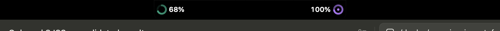
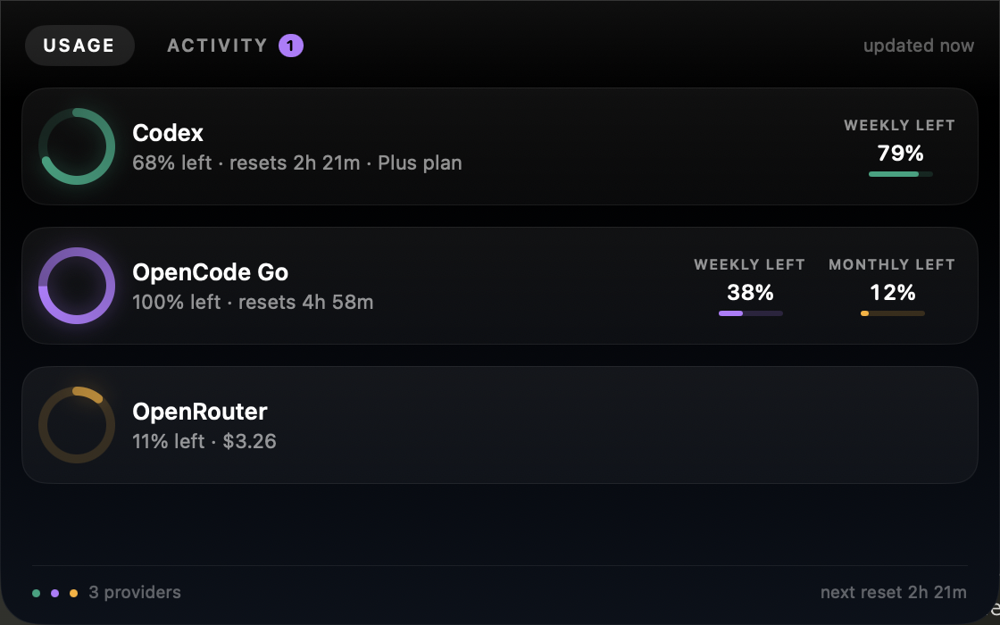
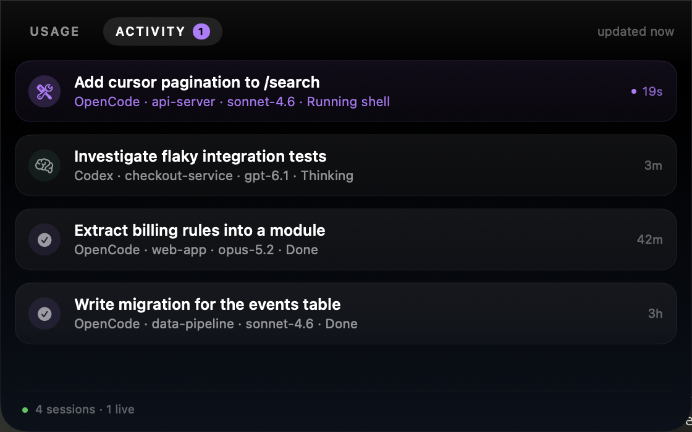

# NotchStats

**Your AI usage limits and live coding sessions, living in the MacBook notch.**


NotchStats is a tiny native macOS overlay that turns the notch into a
Dynamic-Island-style surface. It shows how much of your ChatGPT/Codex and
OpenCode Go allowance is left, your OpenRouter credit, and what your coding
agents are doing right now — without you switching windows.

Hover the notch for a quick read. Click it for the full panel.

<p align="center">
  
  <br>
  <em>Idle — remaining budget for Codex and OpenCode Go, merged with the camera housing.</em>
</p>

<p align="center">
  
  <br>
  <em>Hover to peek — percentage remaining and reset countdowns.</em>
</p>

<table>
<tr>
<td width="50%"><br><em>Click to expand — usage per provider.</em></td>
<td width="50%"><br><em>Activity — what your agents are doing now.</em></td>
</tr>
</table>

## Features

All figures show **what's left**, not what's been used: a nearly-empty ring means
you're almost out.

- **Codex / ChatGPT limits** — the 5-hour and weekly windows, with reset timers.
- **OpenCode Go limits** — the rolling (5h), weekly and monthly allowances from
  the official quota endpoint, including when you're rate-limited.
- **OpenRouter credit** — remaining balance, straight from the API.
- **Live sessions** — OpenCode and Codex conversations with their current state
  (thinking, running a tool, responding, compacting, done), the project and
  model, and how long ago they last moved. Click a row to jump to your terminal.
- **Notch-native** — a borderless, non-activating panel that hugs the physical
  camera housing, floats above the menu bar on every Space, and lets clicks pass
  through everywhere else.
- **Local-first** — no account, no telemetry, no proxy. It reads credentials your
  tools already wrote and calls only the providers' own endpoints.

## Requirements

- macOS 14 (Sonoma) or later. Built and tested on macOS 27.
- A MacBook with a notch (falls back to a menu-bar pill elsewhere).
- OpenCode v2 for OpenCode Go usage and live OpenCode sessions.
- Codex for Codex limits and Codex sessions.

## Install

**curl**

```sh
curl -fsSL https://raw.githubusercontent.com/unnipv/notch-stats/main/scripts/install.sh | bash
```

**Homebrew**

```sh
brew tap unnipv/notch-stats
brew install --cask notch-stats
```

**bun / npm**

```sh
bunx notch-stats
```

**From source**

```sh
git clone https://github.com/unnipv/notch-stats
cd notch-stats
./build.sh
open build/NotchStats.app
```

Builds are unsigned, so the installer strips the Gatekeeper quarantine flag for
you. If you download it by hand and macOS complains, run
`xattr -dr com.apple.quarantine /Applications/NotchStats.app`.

## Connect your providers

**There is no sign-in and no API key to paste into NotchStats.** It reads the
credentials your tools already wrote, then calls the providers' own endpoints.
If a provider isn't set up, its row shows an actionable caption (for example
*"No credentials — run `codex login`"*) instead of failing silently.

| Provider | What you need first | Where NotchStats reads it |
| --- | --- | --- |
| **Codex / ChatGPT** | Sign in with the Codex CLI: `codex login` | `~/.codex/auth.json` |
| **OpenCode Go** | Subscribe to Go, then `/connect` in OpenCode (or `opencode auth login`) and pick **OpenCode Go** | `~/.local/share/opencode/opencode.db` → `credential` |
| **OpenRouter** | Add your OpenRouter key in OpenCode's auth | `~/.local/share/opencode/opencode.db` → `credential` |
| **Live OpenCode sessions** | Use OpenCode v2 normally | `opencode.db` → `session_v2`, `session_message` |
| **Live Codex sessions** | Use the Codex CLI normally | `~/.codex/sessions/**/rollout-*.jsonl` |

Then just launch NotchStats — providers appear as their credentials are found,
and **Refresh Now** (⌘R) re-queries immediately.

**Credentials are read-only.** NotchStats never refreshes or rewrites your
tokens — your CLIs own them. If a token has expired you'll see a caption telling
you how to refresh it, not a blank row.

**No special permissions.** The paths above are ordinary files in your home
directory, so macOS never asks for Full Disk Access or Accessibility.

## Running it

NotchStats lives in the menu bar (there is no Dock icon and no window).

| | |
| --- | --- |
| **Start** | `open -a NotchStats` — or launch it from Finder/Spotlight, or enable **Launch at Login** in the menu |
| **Stop** | Menu bar gauge icon → **Quit NotchStats** — or `pkill -f NotchStats` / `osascript -e 'quit app "NotchStats"'` |
| **Is it running?** | `pgrep -f NotchStats` (no output means it's stopped) |
| **Restart** | Quit, then `open -a NotchStats` |
| **Uninstall** | Quit, delete `/Applications/NotchStats.app`, and remove `~/Library/Preferences/dev.notchstats.app.plist` |

**Menu**

- **Refresh Now** (⌘R) — re-query the usage endpoints immediately.
- **Show on External Displays** — off by default. When off, the island only
  appears on the built-in notched display; when on, displays without a notch get
  a floating pill. It floats above the menu bar, so leave it off if it covers
  other windows.
- **Launch at Login** — start automatically when you log in.
- **Quit NotchStats** (⌘Q).

## How it works

NotchStats reads data your tools already keep and calls the providers' own
endpoints. Nothing is uploaded anywhere.

| Widget | Source |
| --- | --- |
| Codex / ChatGPT limits | `~/.codex/auth.json` → `chatgpt.com/backend-api/wham/usage` |
| OpenCode Go limits | `opencode.db` credential → `opencode.ai/zen/go/v1/usage` |
| OpenRouter credit | `opencode.db` credential → `openrouter.ai/api/v1/credits` |
| OpenCode sessions | read-only `~/.local/share/opencode/opencode.db` (`session_v2`, `session_message`) |
| Codex sessions | tail of the newest `~/.codex/sessions/**/rollout-*.jsonl` |

The usage endpoints for Codex and OpenCode Go are the same undocumented ones
their own clients use, so they can change without notice — that's why
NotchStats shows an explicit error caption rather than a wrong number.

## Performance

Designed to be invisible. Measured on a MacBook Air M2 with a notched built-in
display:

- **~0.5% CPU idle, ~22 MB physical footprint.**
- Sessions refresh every 2.5s with a handful of indexed SQLite reads; usage
  refreshes every ~60s with jitter.
- Countdowns are computed from `Date` rather than ticked, and nothing animates
  on a loop — a repeating animation would keep the window's display link active
  and stop the app ever idling.
- No cost engine, no chart library, no updater, no background subprocesses.

## How it compares

NotchStats is deliberately small. Roughly 2k lines of Swift, one window, no
subprocesses. That trade buys and costs:

**Where it wins**

- **Light.** ~0.5% CPU / ~22 MB, versus the cost-engine, chart-library and
  auto-updater stacks many notch apps carry.
- **Zero-config.** No hooks installed into your agent configs, no bridge binary,
  no socket, no API keys to paste. It reads what your CLIs already wrote.
- **Read-only credentials.** It never rotates or rewrites your tokens, so it
  can't break your logins.
- **OpenCode Go + OpenRouter** support, which several notch apps don't have.

**Where others are ahead**

- [**CodexIsland**](https://github.com/Felix-wu998/codex-island) has local
  token/cost estimates, charts, threshold alerts, Sparkle auto-update, English +
  Simplified Chinese, and macOS 13 support. It's older and more battle-tested.
- [**CodeIsland**](https://github.com/wxtsky/CodeIsland) and
  [**Code Island**](https://github.com/erha19/code-island) track ~12 agents via
  hooks with per-tool live streaming, notifications and mascots — more coverage,
  at the cost of installing hooks and running a bridge.
- [**Codenotch**](https://github.com/vinzdg/codenotch) adds Cursor, Copilot and
  Kimi rings, plus a phone companion app.
- Others (boring.notch, NotchNook, NotchBar) are general-purpose notch utilities
  — music, files, system stats — rather than agent usage.

**Honest gaps in NotchStats**

- macOS 14+, and OpenCode Go usage needs OpenCode v2.
- No Claude/Anthropic limits yet.
- No auto-update; unsigned (ad-hoc) builds.
- Codex session state is coarse — it summarises the newest rollout file.

## Development

```sh
swift build          # compile
swift test           # unit tests
./build.sh           # assemble build/NotchStats.app (universal, ad-hoc signed)
./scripts/make-icns.sh
```

Test hooks (development only):

```sh
NOTCHSTATS_STATE=collapsed|peek|expanded
NOTCHSTATS_PAGE=activity
NOTCHSTATS_DEBUG_BG=1     # tint the island so its bounds are visible in screenshots
NOTCHSTATS_DUMP=1         # print notch geometry + status item state to stderr
scripts/cpu.sh <pid> 10   # true CPU usage over a window
```

## Releasing

Push a tag; CI builds a universal bundle and attaches `NotchStats.zip` to the
GitHub release.

```sh
git tag v0.1.0 && git push origin v0.1.0
```

After the release completes, update the `sha256` in
`packaging/homebrew/notch-stats.rb` to the published archive's checksum.

## License

MIT — see [LICENSE](LICENSE).
