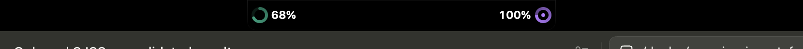
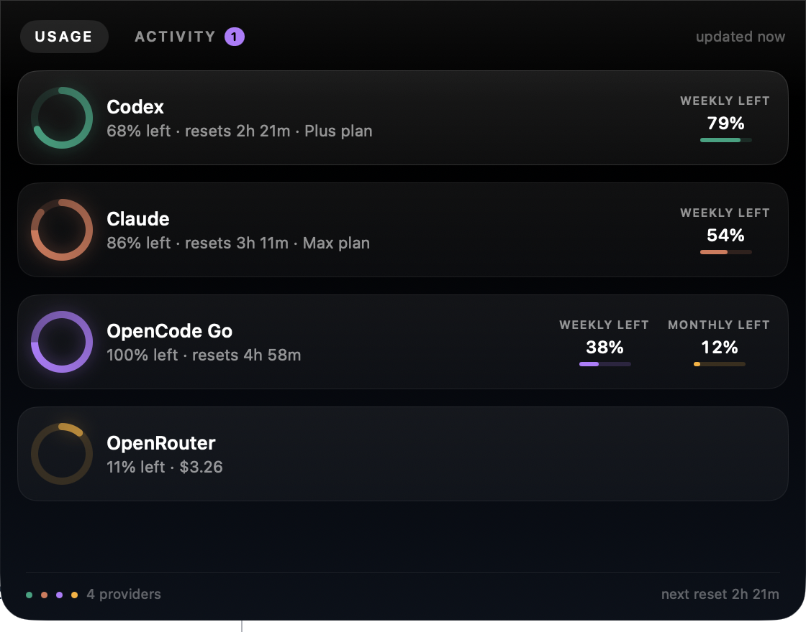
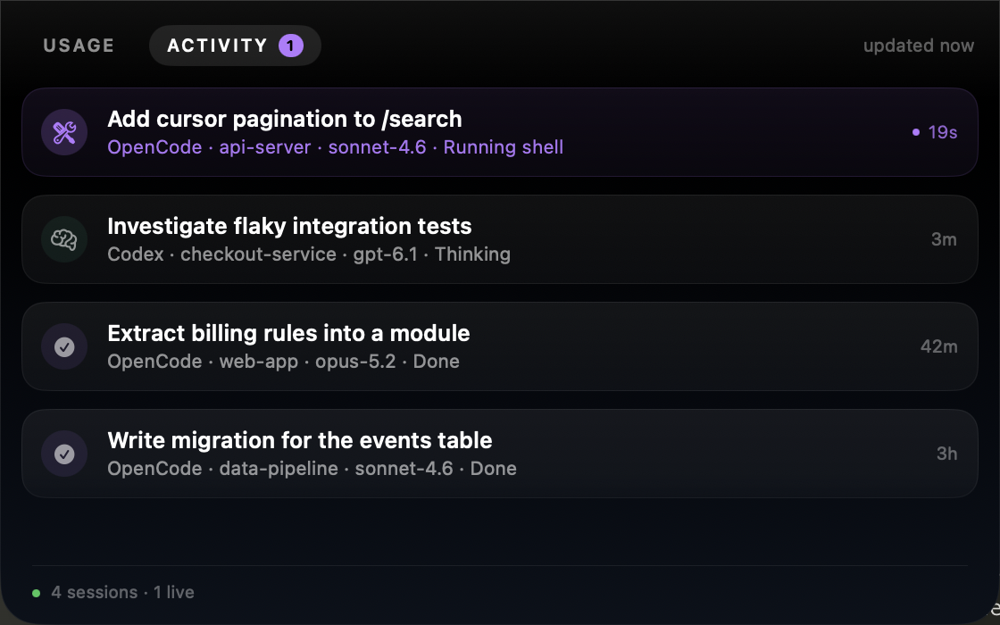

# NotchStats

**Your AI usage limits and live coding sessions, living in the MacBook notch.**


NotchStats is a tiny native macOS overlay that turns the notch into a
Dynamic-Island-style surface. It shows how much of your ChatGPT/Codex, Claude,
Antigravity/Gemini and OpenCode Go allowance is left, your OpenRouter credit,
and what your coding agents are doing right now — without you switching windows.

Hover the notch for a quick read. Click it for the full panel.

<p align="center">
  
  <br>
  <em>Idle — remaining budget for Codex and OpenCode Go, merged with the camera housing.</em>
</p>

<p align="center">
  
  <br>
  <em>Hover to peek — percentage remaining and reset countdowns.</em>
</p>

<table>
<tr>
<td width="50%"><br><em>Click to expand — usage per provider.</em></td>
<td width="50%"><br><em>Activity — what your agents are doing now.</em></td>
</tr>
</table>

## Features

All figures show **what's left**, not what's been used: a nearly-empty ring means
you're almost out.

- **Codex / ChatGPT limits** — the 5-hour window, with reset timer.
- **Claude limits** — the 5-hour and weekly windows when you sign in with a
  Pro/Max account. An API-key login has no usage limits, and NotchStats says so
  rather than showing a made-up number. Or use **Enable usage tap** (no login,
  no Keychain): NotchStats reads the limits Claude Code passes to its status
  line.
- **Gemini / Antigravity limits** — real quota pools (`Gemini`, or `Pro` /
  `Flash` when distinct, plus `Partner` for 3P Claude/GPT models) with reset
  countdowns and plan tier from your local `agy` / Antigravity login. Omitted
  when Antigravity isn't installed or signed in. Or use **Enable usage tap**
  (no login, no Keychain): NotchStats reads the 5-hour and weekly quota `agy`
  passes to its status line.
- **Anthropic API spend** — if you use a pay-as-you-go Anthropic key from
  OpenCode, the month-to-date and today's spend, totalled from OpenCode's own
  per-message cost ledger. Anthropic has no public credit-balance endpoint, so
  this is spend, not remaining credit.
- **OpenCode Go limits** — the rolling (5h), weekly and monthly allowances from
  the official quota endpoint, including when you're rate-limited.
- **OpenRouter credit** — remaining balance, straight from the API.
- **Live sessions** — OpenCode and Codex conversations with their current state
  (thinking, running a tool, responding, compacting, done), the project and
  model, and how long ago they last moved. Click a row to jump to your terminal.
- **Notch-native** — a borderless, non-activating panel that hugs the physical
  camera housing, floats above the menu bar on every Space, and lets clicks pass
  through everywhere else.
- **Local-first** — no account, no telemetry, no proxy. It reads credentials your
  tools already wrote and calls only the providers' own endpoints.

## Requirements

- macOS 14 (Sonoma) or later. Built and tested on macOS 27.
- A MacBook with a notch (falls back to a menu-bar pill elsewhere).
- OpenCode v2 for OpenCode Go usage, Anthropic API spend and live OpenCode
  sessions.
- Codex for Codex limits and Codex sessions.
- Claude Code for Claude limits.
- Antigravity (`agy` CLI / Antigravity IDE) or Gemini CLI for Gemini limits.

## Install

**curl**

```sh
curl -fsSL https://raw.githubusercontent.com/unnipv/notch-stats/main/scripts/install.sh | bash
```

**Homebrew**

```sh
brew tap unnipv/notch-stats
brew trust unnipv/notch-stats        # Homebrew requires trusting third-party taps
brew install --cask notch-stats
```

**bun / npm**

```sh
bunx notch-stats
```

**From source**

```sh
git clone https://github.com/unnipv/notch-stats
cd notch-stats
./build.sh
open build/NotchStats.app
```

Builds are unsigned, so the installer strips the Gatekeeper quarantine flag for
you. If you download it by hand and macOS complains, run
`xattr -dr com.apple.quarantine /Applications/NotchStats.app`.

## Connect your providers

**There is no sign-in and no API key to paste into NotchStats.** It reads the
credentials your tools already wrote, then calls the providers' own endpoints.
If a provider isn't set up, its row shows an actionable caption (for example
*"No credentials — run `codex login`"*) instead of failing silently.

| Provider | What you need first | Where NotchStats reads it |
| --- | --- | --- |
| **Codex / ChatGPT** | Sign in with the Codex CLI: `codex login` | `~/.codex/auth.json` |
| **Claude** | Sign in with Claude Code: `claude` | `~/.claude/.credentials.json`, captured `0600` snapshot (**Capture Claude login…**), or launch-only Keychain read if opted in |
| **Gemini (Antigravity)** | Sign in with Antigravity (`agy` CLI or Antigravity IDE) or Gemini CLI | `JETSKI_OAUTH_TOKEN`, `~/.gemini/oauth_creds.json`, captured `0600` snapshot (**Capture Gemini login…**), or launch-only Keychain read if opted in |
| **Anthropic API** | Add an Anthropic API key in OpenCode (`/connect` → **Anthropic**, or `opencode auth login`) | `opencode.db` → `credential` (key) + per-message `cost` |
| **OpenCode Go** | Subscribe to Go, then `/connect` in OpenCode (or `opencode auth login`) and pick **OpenCode Go** | `~/.local/share/opencode/opencode.db` → `credential` |
| **OpenRouter** | Add your OpenRouter key in OpenCode's auth | `~/.local/share/opencode/opencode.db` → `credential` |
| **Live OpenCode sessions** | Use OpenCode v2 normally | `opencode.db` → `session_v2`, `session_message` |
| **Live Codex sessions** | Use the Codex CLI normally | `~/.codex/sessions/**/rollout-*.jsonl` |

Then just launch NotchStats — providers appear as their credentials are found,
and **Refresh Now** (⌘R) re-queries immediately.

**Credentials are read-only.** NotchStats never refreshes or rewrites your
tokens — your CLIs own them. If a token has expired you'll see a caption telling
you how to refresh it, not a blank row.

**No special permissions.** The paths above are ordinary files in your home
directory; macOS never asks for Full Disk Access or Accessibility.

**Claude, Gemini, and the keychain.** Background polling performs **zero**
Keychain secret reads — NotchStats can never interrupt you with a recurring
keychain password dialog. It checks plain files first (`~/.claude/.credentials.json`,
`~/.gemini/oauth_creds.json`, or env vars `CLAUDE_CODE_OAUTH_TOKEN` /
`JETSKI_OAUTH_TOKEN`), which never prompt. When a login lives only in the macOS
login Keychain, the row says *"Claude login not shared — Capture in menu"* or
*"Gemini login found, not shared"*. Click **Capture Claude login…** or **Capture
Gemini login…** in the menu bar once: macOS may ask for your password on that
explicit click, and NotchStats saves an app-private `0600` snapshot under
`~/Library/Application Support/NotchStats/credentials/<provider>.json` containing
only `accessToken`, `expiresAt`, and `capturedAt` (never refresh tokens). Every
subsequent poll reads that snapshot file, never the Keychain, and you can delete
it anytime with **Forget Claude login** / **Forget Gemini login**.

Ad-hoc signing (`codesign -s -`) changes the app's CDHash on every rebuild and
invalidates any "Always Allow" ACL grant; run `./scripts/make-signing-cert.sh`
once to create a persistent `"NotchStats Dev"` signing certificate so `./build.sh`
(or `NOTCHSTATS_SIGN_IDENTITY`) keeps the grant across rebuilds. Even with
ad-hoc signing, capture-once removes background prompts completely. Every
non-interactive Keychain query sets **both** `kSecUseAuthenticationUIFail` and
`LAContext.interactionNotAllowed = true`. See
[docs/claude-login-troubleshooting.md](docs/claude-login-troubleshooting.md) for
full details and Claude CLI logout troubleshooting. If you sign in with an
**API key** rather than a Pro/Max account, Anthropic reports that usage limits
don't apply to API organisations — NotchStats shows that instead of inventing a
number. When that key comes from OpenCode, a separate **Anthropic API** row
totals your spend from OpenCode's local ledger. Every provider is time-boxed, so
a stalled request can never stall the others.

## Running it

NotchStats lives in the menu bar (there is no Dock icon and no window).

| | |
| --- | --- |
| **Start** | `open -a NotchStats` — or launch it from Finder/Spotlight, or enable **Launch at Login** in the menu |
| **Stop** | Menu bar gauge icon → **Quit NotchStats** — or `pkill -f NotchStats` / `osascript -e 'quit app "NotchStats"'` |
| **Is it running?** | `pgrep -f NotchStats` (no output means it's stopped) |
| **Restart** | Quit, then `open -a NotchStats` |
| **Uninstall** | Quit, delete `/Applications/NotchStats.app`, and remove `~/Library/Preferences/dev.notchstats.app.plist` |

**Menu**

- **Refresh Now** (⌘R) — re-query the usage endpoints immediately.
- **Capture Claude login…** / **Forget Claude login** — explicitly read Claude's
  Keychain login once into an app-private `0600` snapshot (or delete that
  snapshot).
- **Capture Gemini login…** / **Forget Gemini login** — explicitly read
  Antigravity/Gemini's Keychain login once into an app-private `0600` snapshot
  (or delete that snapshot).
- **Show on External Displays** — off by default. When off, the island only
  appears on the built-in notched display; when on, displays without a notch get
  a floating pill. It floats above the menu bar, so leave it off if it covers
  other windows.
- **Allow Keychain Access (read once at launch)** — off by default. When on,
  NotchStats attempts one silent, non-interactive Keychain read at launch or
  wake (for stably signed builds with an Always Allow grant). Background polls
  never read the Keychain.
- **Launch at Login** — start automatically when you log in.
- **Quit NotchStats** (⌘Q).

## How it works

NotchStats reads data your tools already keep and calls the providers' own
endpoints. Nothing is uploaded anywhere.

| Widget | Source |
| --- | --- |
| Codex / ChatGPT limits | `~/.codex/auth.json` → `chatgpt.com/backend-api/wham/usage` |
| Claude limits | `~/.claude/.credentials.json` → `api.anthropic.com/api/oauth/usage` |
| Gemini / Antigravity limits | `agy` Keychain (`gemini`/`antigravity`) or `~/.gemini/oauth_creds.json` → `daily-cloudcode-pa.googleapis.com/v1internal:{loadCodeAssist,retrieveUserQuota}` |
| Anthropic API spend | `opencode.db` → `session_message` (`cost` on `anthropic` assistant messages) |
| OpenCode Go limits | `opencode.db` credential → `opencode.ai/zen/go/v1/usage` |
| OpenRouter credit | `opencode.db` credential → `openrouter.ai/api/v1/credits` |
| OpenCode sessions | read-only `~/.local/share/opencode/opencode.db` (`session_v2`, `session_message`) |
| Codex sessions | tail of the newest `~/.codex/sessions/**/rollout-*.jsonl` |

The usage endpoints for Codex, Claude, Gemini/Antigravity and OpenCode Go are
the same undocumented ones their own clients use, so they can change without
notice — that's why NotchStats shows an explicit error caption rather than a
wrong number.

## Performance

Designed to be invisible. Measured on a MacBook Air M2 with a notched built-in
display:

- **~0.1–0.2% CPU idle, ~21 MB physical footprint** (60 s `scripts/cpu.sh`
  windows and `vmmap`, release build, notched M-series display; 4–5 threads, no
  child processes after 10 minutes). The same method measured 0.6–0.8% before
  the performance pass.
- Sessions refresh every 2.5s while something is working or the panel is open
  and every 6s otherwise, and only re-read a database when it has changed;
  usage refreshes every ~60s with jitter, staggered across providers.
- Countdowns are computed from `Date` rather than ticked, and nothing animates
  on a loop — a repeating animation would keep the window's display link active
  and stop the app ever idling.
- No cost engine, no chart library, no updater, and no background subprocesses
  (credentials are read directly from disk or, when opted in, via non-interactive
  Security framework calls).

## How it compares

NotchStats is deliberately small. Roughly 2k lines of Swift, one window, no
subprocesses. That trade buys and costs:

**Where it wins**

- **Light.** ~0.2% CPU / ~21 MB, versus the cost-engine, chart-library and
  auto-updater stacks many notch apps carry.
- **Zero-config.** No hooks installed into your agent configs, no bridge binary,
  no socket, no API keys to paste. It reads what your CLIs already wrote.
- **Read-only credentials.** It never rotates or rewrites your tokens, so it
  can't break your logins.
- **Codex + Claude + Gemini + Anthropic API + OpenCode Go + OpenRouter** in one
  place, including Antigravity/Gemini and OpenCode Go quotas.

**Where others are ahead**

- [**CodexIsland**](https://github.com/Felix-wu998/codex-island) has local
  token/cost estimates, charts, threshold alerts, Sparkle auto-update, English +
  Simplified Chinese, and macOS 13 support. It's older and more battle-tested.
- [**CodeIsland**](https://github.com/wxtsky/CodeIsland) and
  [**Code Island**](https://github.com/erha19/code-island) track ~12 agents via
  hooks with per-tool live streaming, notifications and mascots — more coverage,
  at the cost of installing hooks and running a bridge.
- [**Codenotch**](https://github.com/vinzdg/codenotch) adds Cursor, Copilot and
  Kimi rings, plus a phone companion app.
- Others (boring.notch, NotchNook, NotchBar) are general-purpose notch utilities
  — music, files, system stats — rather than agent usage.

**Honest gaps in NotchStats**

- macOS 14+, and OpenCode Go usage needs OpenCode v2.
- No local token/cost estimates beyond OpenCode's own Anthropic ledger, no
  charts and no threshold alerts.
- Claude limits need a Pro/Max login; API-key accounts have none to show.
  Anthropic API spend is totalled locally from OpenCode, because Anthropic
  exposes no credit-balance API.
- No auto-update; unsigned (ad-hoc) builds.
- Codex session state is coarse — it summarises the newest rollout file.

## Development

```sh
swift build                      # compile
swift test                       # unit tests
./scripts/make-signing-cert.sh   # optional one-time "NotchStats Dev" cert so Keychain grants stick
./build.sh                       # assemble build/NotchStats.app (uses NOTCHSTATS_SIGN_IDENTITY / "NotchStats*" / ad-hoc)
./scripts/make-icns.sh
```

Test hooks (development only — every one is read from the environment at
launch, so a normal launch from Finder or at login never runs any of them; the
snapshot renders the view without the window blur, so it cannot show the glass):

```sh
NOTCHSTATS_STATE=collapsed|peek|expanded
NOTCHSTATS_PAGE=activity
NOTCHSTATS_DEBUG_BG=1     # tint the island so its bounds are visible in screenshots
NOTCHSTATS_DUMP=1         # print notch geometry + status item state to stderr
NOTCHSTATS_DEMO=1|errors|urgent|empty|three|four
                          # fictional data, no network or file reads; the variants
                          # exercise error, tight-quota, empty and fewer-row panels
NOTCHSTATS_SNAPSHOT=/path/out.png
                          # render the island once over a stand-in wallpaper, write a
                          # PNG and quit (no screen-recording permission needed)
scripts/cpu.sh <pid> 10   # true CPU usage over a window
```

## Releasing

Push a tag; CI builds a universal bundle and attaches `NotchStats.zip` to the
GitHub release.

```sh
git tag v0.1.0 && git push origin v0.1.0
```

After the release completes, update the `sha256` in
`packaging/homebrew/notch-stats.rb` to the published archive's checksum.

## License

MIT — see [LICENSE](LICENSE).
